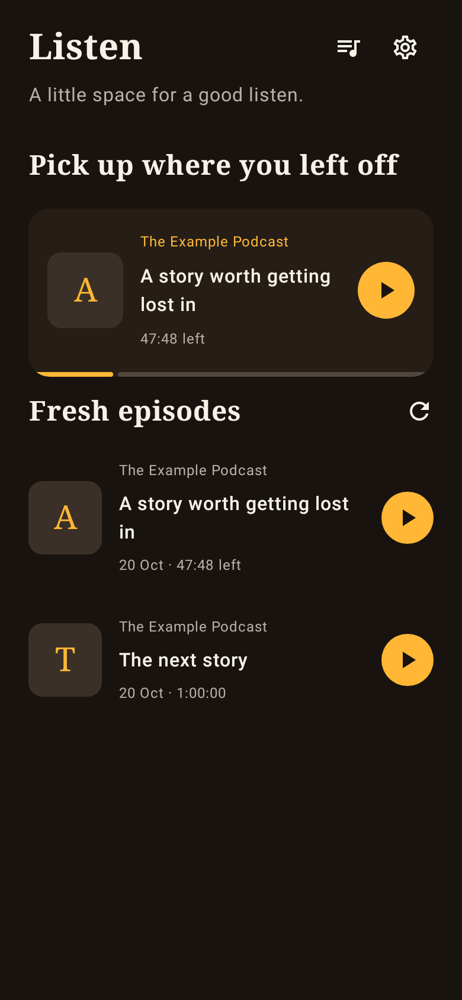
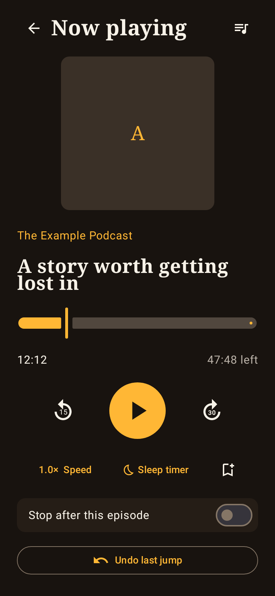

# Android Podcast Player

**An ad-free podcast player for Android, built with AI.**

Podcasts is a native Kotlin and Jetpack Compose app with warm dark and light themes, offline listening, and playback that moves forwards through a show. Built with AI assistance using OpenAI Codex, and released under the [MIT licence](LICENSE).

This is an **early preview**, not a finished store release. A fresh installation starts empty: no default subscriptions, personal recommendations, accounts, analytics or embedded API keys. Search for shows yourself, add an RSS link, or import subscriptions from another player.

## Features

- Podcast discovery through Apple's directory, direct RSS/Atom links, and OPML subscription import/export.
- Streaming and downloads for offline listening, with a Wi-Fi-only download option.
- Background playback, Android media notification, lock-screen and Bluetooth controls.
- Saved listening positions, played/unplayed status, and a persistent queue with reordering.
- Playback speed, 15-second rewind, 30-second forward, bookmarks, and undo for accidental jumps.
- Sleep timer and **Stop after this episode**.
- Inline chapter markers when supplied by the publisher.
- Warm dark and light themes. Browsing a show or episode never starts playback.

**Ad-free refers to the app:** there are no advertising SDKs, banners or paid upgrades. Adverts recorded or inserted into a publisher's episode audio still play.

## Playback order

The episode list can show newest first without controlling what plays next:

1. Finish the current episode and mark it played.
2. Stop if **Stop after this episode** or the end-of-episode timer is enabled.
3. Otherwise play anything the listener explicitly queued.
4. If automatic continuation is enabled, play the next newer unplayed full episode in the same show, using season/episode metadata or publication dates.
5. At the newest available episode, stop. Never wrap backwards through the archive or switch to an unrelated show automatically.

Publisher metadata affects ordering. If the feed provides no usable ordering information, the player stops rather than guessing.

## Screenshots

Screenshots use fictional sample data. Publisher artwork loads from feeds when using the app.

| Listen | Player | Discover |
| --- | --- | --- |
|  |  |  |

## Build and try it

Requirements: **JDK 17**, **Android SDK 35**, and Android 8.0 or newer on the phone. The Gradle wrapper downloads its pinned Gradle distribution and dependencies on the first build.

1. Clone this repository and open it in Android Studio.
2. Configure the local Android SDK using Android Studio, `ANDROID_HOME`, or an untracked `local.properties` file.
3. Build, test and run lint:

```sh
./gradlew testDebugUnitTest lintDebug assembleDebug
```

On Windows:

```powershell
.\gradlew.bat testDebugUnitTest lintDebug assembleDebug
```

The test APK is written to `app/build/outputs/apk/debug/app-debug.apk`. Copy it to your phone and open it to install. Debug builds are for testing; use a private production signing key before distributing a stable release. Signing keys and generated APKs are excluded from source control.

The optional PowerShell helper is `scripts/build-android.ps1`. It supports `-Offline` once dependencies are cached, and an optional `-GradleExecutable` path. No other local project is needed to build this app.

## Tests

Tests cover forwards episode order, season transitions, queue precedence, stop behaviour, RSS/Atom parsing, chapter metadata, OPML, local persistence, fresh-install defaults, and the difference between browsing and playing. Screen tests render fictional data; no listening account or API key is required.

An optional live catalogue check accepts explicit queries:

```powershell
.\scripts\check-catalogue.ps1 -Queries 'science podcasts', 'history podcasts'
```

Its downloaded samples and report stay in the ignored `.tooling/catalogue` folder. The corresponding smoke test is skipped when those local samples are absent. Normal tests run without live catalogue access; the first test run may need to download Robolectric's Android runtime.

Actual phone playback, interruptions, Bluetooth and airplane-mode listening still need device testing.

## Privacy and credentials

- No app account, analytics, advertising SDK, backend server or bundled credentials.
- Searches go to Apple; feeds, artwork and audio come from their providers. Those providers receive the network requests needed to serve their content.
- Subscriptions, positions, bookmarks, queue and downloads are stored on the phone. Uninstalling removes app data.
- Private feed links can contain access tokens. They are stored locally and excluded from automatic app backup. OPML exports include feed links, so keep exports private.
- OPML transfers subscriptions only, not listening history or positions. There is no cloud progress sync in this version.

Do not commit private feeds, OPML exports, tokens, database files, signing keys or local configuration. The repository's ignore rules exclude these common local files.

## Roadmap

Chromecast, Android Auto library browsing, widgets, named playlists, automatic downloads, new-episode notifications, SD-card selection and multi-device sync are not included yet. Broader directory support and per-show continuation rules are also possible follow-up work.

Public RSS feeds contain the episodes a publisher currently makes available. Subscriber-only archives need an authorised feed; content restricted to a platform's DRM player is outside this preview.

## Licence

[MIT](LICENSE). Third-party libraries retain their own licences; podcast audio, artwork and metadata belong to their respective owners.
